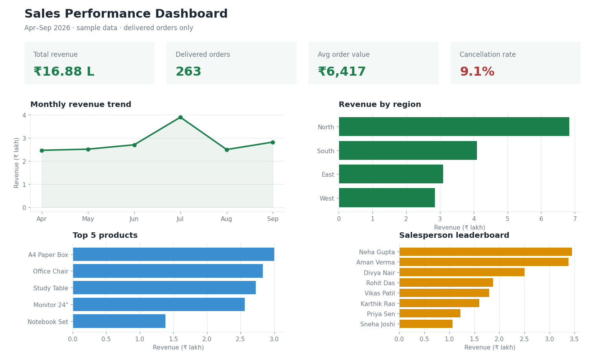

# Google Sheets Sales Dashboard

A one-page sales dashboard built in Google Sheets with formulas only. No scripts or add-ons are needed, and it updates automatically when new rows are added to the data tab.



*Preview generated from the sample data in this repo. All names and numbers are dummy data.*

## What the dashboard shows

- **KPIs**: total revenue, delivered orders, average order value, cancellation rate
- **Monthly revenue trend**
- **Revenue by region**
- **Top 5 products by revenue**
- **Salesperson leaderboard**, filterable by region with a dropdown

## Sheet structure

| Tab | Purpose |
|---|---|
| `Data` | Raw order data, one row per order (`data/sample_sales_data.csv`) |
| `Dashboard` | KPIs, summary tables and charts, all driven by formulas |

`Data` columns: **A** Date · **B** Order ID · **C** Region · **D** Salesperson · **E** Product · **F** Category · **G** Units · **H** Unit Price · **I** Revenue · **J** Status

## Key formulas

Cell `B1` on the Dashboard holds a region dropdown (`All`, `North`, `South`, `East`, `West`) made with Data validation.

**Total revenue**
```
=SUMIFS(Data!I:I, Data!J:J, "Delivered", Data!C:C, IF($B$1="All", "*", $B$1))
```
Adds up the Revenue column, but only for rows where Status is "Delivered". If the dropdown says "All", the `*` wildcard matches every region. Otherwise it matches only the selected region.

**Delivered orders**
```
=COUNTIFS(Data!J:J, "Delivered", Data!C:C, IF($B$1="All", "*", $B$1))
```
Counts the rows where Status is "Delivered", using the same region filter as above.

**Average order value**
```
=IFERROR(B3 / C3, 0)
```
Divides total revenue (B3) by delivered orders (C3). IFERROR shows 0 instead of an error when there are no orders.

**Cancellation rate**
```
=IFERROR(COUNTIF(Data!J2:J, "Cancelled") / COUNTA(Data!J2:J), 0)
```
Counts the cancelled orders and divides by the total number of orders. Format the cell as a percentage.

**Monthly revenue trend**
```
=QUERY(Data!A1:J, "select month(A)+1, sum(I) where J = 'Delivered' group by month(A)+1 label month(A)+1 'Month', sum(I) 'Revenue'", 1)
```
Groups the delivered orders by month and totals the revenue for each one. QUERY's `month()` starts counting at 0, so `+1` turns it into normal month numbers (1 = January). For data that covers more than one year, also group by `year(A)`.

**Revenue by region**
```
=QUERY(Data!A1:J, "select C, sum(I) where J = 'Delivered' group by C order by sum(I) desc label sum(I) 'Revenue'", 1)
```
Totals the delivered revenue for each region and sorts the regions from highest to lowest.

**Top 5 products**
```
=QUERY(Data!A1:J, "select E, sum(I) where J = 'Delivered' group by E order by sum(I) desc limit 5 label sum(I) 'Revenue'", 1)
```
Totals the revenue for each product, sorts from highest to lowest, and keeps only the first 5.

**Salesperson leaderboard (with region filter)**
```
=QUERY(Data!A1:J, "select D, sum(I), count(B) where J = 'Delivered'" & IF($B$1="All", "", " and C = '" & $B$1 & "'") & " group by D order by sum(I) desc label sum(I) 'Revenue', count(B) 'Orders'", 1)
```
Totals each salesperson's revenue and order count. The IF adds a region condition to the query only when a specific region is selected in B1.

## How to use it

1. Create a new Google Sheet and rename the first tab to `Data`.
2. Go to **File → Import → Upload**, choose `data/sample_sales_data.csv`, and select **Replace current sheet**.
3. Add a `Dashboard` tab and paste in the formulas above.
4. Insert charts (**Insert → Chart**) from the summary tables.

To use your own data, keep the same column order in the `Data` tab and the dashboard will update automatically.

## Skills shown

Google Sheets · QUERY · SUMIFS / COUNTIFS · dynamic filters with Data validation · dashboard design · data visualization
